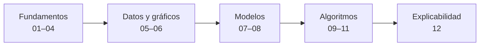

# Aprendiendo R con PGF

Curso práctico de R, desde lo elemental hasta algoritmos de Machine Learning, **con ejemplos tomados de proyectos reales de ingeniería**: la tesis de gestión energética de la planta Oil Malal y el sistema de posicionamiento angular con servodrive.

Es el curso hermano de [Aprendiendo Python con PGF](https://github.com/PGF-Free-Knowledge/aprendiendo-python-con-pgf): mismos datos y mismos problemas, resueltos en R.

Cada lección tiene:

- un programa listo para ejecutar (`.R`);
- un `README.md` con los pasos exactos, la explicación del código y **el resultado real** que debe aparecer en la consola;
- un ejercicio para practicar.

---

## Antes de empezar

1. Instala **R** desde [cran.r-project.org](https://cran.r-project.org) y luego **RStudio Desktop** desde [posit.co](https://posit.co/download/rstudio-desktop/).
2. Descarga este repositorio (botón verde **Code → Download ZIP**) y descomprímelo.
3. Abre el archivo `aprendiendo-r-con-pgf.Rproj` con doble clic. RStudio queda trabajando desde la carpeta del repositorio, y así los programas encuentran la carpeta `datos/`.
4. En la consola de RStudio instala el único paquete adicional (los paquetes `class` y `rpart` ya vienen con R):

```r
install.packages("randomForest")
```

5. Ejecuta las lecciones en orden.

---

## Ruta de aprendizaje



| Nº | Lección | Qué se aprende | Proyecto |
|---:|---|---|---|
| 01 | [Variables y operaciones](lecciones/01_variables_y_operaciones/README.md) | Asignación `<-`, tipos de datos, operaciones y conversión de unidades | Oil Malal · Goniómetro |
| 02 | [Condicionales y ciclos](lecciones/02_condicionales_y_ciclos/README.md) | Vectores, `if`, `else` y `for` para revisar mes a mes | Oil Malal |
| 03 | [Funciones](lecciones/03_funciones/README.md) | `function`, parámetros, valores por defecto y funciones sobre vectores | Oil Malal · Goniómetro |
| 04 | [Vectores y tablas](lecciones/04_vectores_y_tablas/README.md) | Leer un CSV, sumar, agrupar con `tapply` y ordenar | Inventario de motores |
| 05 | [data.frame: leer y resumir](lecciones/05_data_frames_leer_y_resumir/README.md) | `summary`, columnas nuevas, `aggregate` y `subset` | Oil Malal |
| 06 | [Gráficos](lecciones/06_graficos/README.md) | Barras y dispersión con R base, guardados en PNG | Oil Malal |
| 07 | [Regresión lineal](lecciones/07_regresion_lineal/README.md) | `lm`, R² y predicción | Línea base · Distancia de parada |
| 08 | [Validación «dejar uno fuera»](lecciones/08_validacion_dejar_uno_fuera/README.md) | Entrenar, predecir y comparar modelos con datos no vistos | Oil Malal |
| 09 | [k vecinos más cercanos](lecciones/09_vecinos_mas_cercanos_knn/README.md) | Clasificación, escalamiento, exactitud y matriz de confusión | Eficiencia mensual |
| 10 | [Árbol de decisión](lecciones/10_arbol_de_decision/README.md) | Reglas legibles con `rpart` y sobreajuste | Eficiencia mensual |
| 11 | [Random Forest](lecciones/11_random_forest/README.md) | Conjunto de árboles e importancia de variables | Consumo mensual |
| 12 | [Explicabilidad](lecciones/12_explicabilidad/README.md) | Importancia por permutación y dependencia parcial | Consumo mensual |

---

## Datos

Los datos están en la carpeta [`datos/`](datos/README.md) y provienen de proyectos reales.

## Resultados verificados

Los resultados que aparecen en cada lección son la salida real de los programas, ejecutados automáticamente con R en GitHub Actions ([`ejecutar-lecciones.yml`](.github/workflows/ejecutar-lecciones.yml)). La versión de R y de los paquetes usados está en [`lecciones/version_r.txt`](lecciones/version_r.txt). Con otra versión de R, los resultados de las lecciones 09 a 12 pueden variar levemente, porque dependen de sorteos al azar.

## Estructura

```text
aprendiendo-r-con-pgf/
├── aprendiendo-r-con-pgf.Rproj   Proyecto de RStudio (abrir con doble clic)
├── datos/                        Datos reales de los proyectos
└── lecciones/
    ├── 01_variables_y_operaciones/
    ├── ...
    └── 12_explicabilidad/
```

## Más proyectos

Portafolio completo: [PGF_Portfolio](https://github.com/PGF-Free-Knowledge/PGF_Portfolio)
