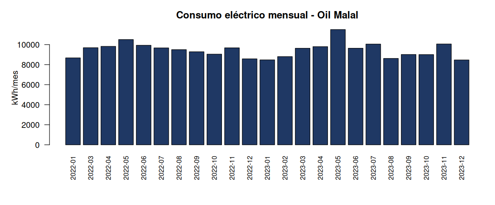
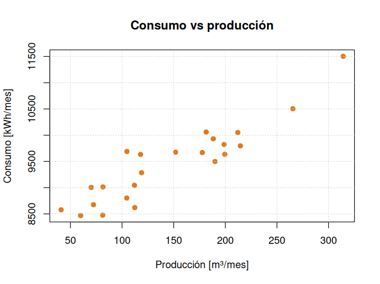

# Lección 06 · Gráficos

**Objetivo:** Dibujar el consumo mensual en barras y la relación consumo–producción en un gráfico de dispersión, y guardarlos como imagen.

**Proyecto asociado:** Tesis Oil Malal.

## Paso a paso

1. Abre RStudio con el archivo `aprendiendo-r-con-pgf.Rproj` (doble clic). Así R trabaja desde la carpeta principal del repositorio.
2. Abre el archivo [`graficos_oil_malal.R`](graficos_oil_malal.R) (menú **File → Open File**) y léelo junto con la explicación de abajo.
3. Ejecuta el programa completo con el botón **Source** (arriba a la derecha del editor), o escribe en la consola:

```r
source("lecciones/06_graficos/graficos_oil_malal.R")
```

4. Compara lo que aparece en la consola con el **resultado esperado**.

## Qué hace el código

- `png("archivo.png", ...)` abre un archivo de imagen; todo lo que se dibuje después va a ese archivo hasta `dev.off()`, que lo cierra. `invisible()` evita que R muestre un mensaje al cerrarlo.
- `barplot()` dibuja barras. `las = 2` pone las etiquetas del eje en vertical.
- `plot(x, y, pch = 19)` dibuja puntos rellenos. `grid()` agrega la cuadrícula.
- `dir.create(salidas, showWarnings = FALSE)` crea la carpeta `salidas` si no existe.

## Resultado esperado

```text
Gráficos guardados en: lecciones/06_graficos/salidas
```





## Qué aprendimos

Un gráfico muestra de un vistazo lo que la tabla esconde: el consumo sube con la producción, la base de la línea base energética.

## Ejercicio

Agrega una línea horizontal con el consumo promedio en el gráfico de barras, usando `abline(h = mean(df$consumo_kwh), col = "red")` antes de `dev.off()`.
