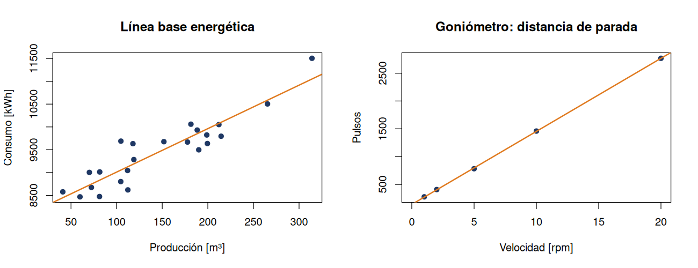

# Lección 07 · Regresión lineal

**Objetivo:** Ajustar una recta a datos reales con `lm()` y medir su calidad con R², en dos proyectos distintos.

**Proyecto asociado:** Línea base energética de Oil Malal y distancia de parada del goniómetro.

## Paso a paso

1. Abre RStudio con el archivo `aprendiendo-r-con-pgf.Rproj` (doble clic). Así R trabaja desde la carpeta principal del repositorio.
2. Abre el archivo [`linea_base_y_goniometro.R`](linea_base_y_goniometro.R) (menú **File → Open File**) y léelo junto con la explicación de abajo.
3. Ejecuta el programa completo con el botón **Source** (arriba a la derecha del editor), o escribe en la consola:

```r
source("lecciones/07_regresion_lineal/linea_base_y_goniometro.R")
```

4. Compara lo que aparece en la consola con el **resultado esperado**.

## Qué hace el código

- `lm(consumo_kwh ~ produccion_m3, data = df)` ajusta la recta E = m·P + b. El símbolo `~` se lee «en función de».
- `coef()` entrega la pendiente y el intercepto; `summary(modelo)$r.squared` entrega el R².
- `predict(modelo, newdata = data.frame(velocidad_rpm = 15))` estima la distancia de parada a una velocidad no medida.
- `print(summary(lben))` muestra el resumen completo: coeficientes, error estándar, valor p y R².
- `abline(modelo)` dibuja la recta ajustada sobre los puntos.

## Resultado esperado

```text
Línea base Oil Malal: E = 9.5210·P + 8058.7   R² = 0.8376
Distancia de parada: d = 131.4·v + 139.9 pulsos   R² = 0.9999
Predicción a 15 rpm: 2111 pulsos

Resumen completo del modelo de línea base:

Call:
lm(formula = consumo_kwh ~ produccion_m3, data = df)

Residuals:
    Min      1Q  Median      3Q     Max 
-507.48 -205.92  -72.61  175.77  633.71 

Coefficients:
               Estimate Std. Error t value Pr(>|t|)    
(Intercept)   8058.6945   148.0728   54.42  < 2e-16 ***
produccion_m3    9.5210     0.9149   10.41  9.6e-10 ***
---
Signif. codes:  0 ‘***’ 0.001 ‘**’ 0.01 ‘*’ 0.05 ‘.’ 0.1 ‘ ’ 1

Residual standard error: 301.4 on 21 degrees of freedom
Multiple R-squared:  0.8376,	Adjusted R-squared:  0.8298 
F-statistic: 108.3 on 1 and 21 DF,  p-value: 9.602e-10
```



## Qué aprendimos

La misma herramienta sirve para la línea base energética de una planta y para la calibración de un sistema de posicionamiento: en ambos casos una relación lineal resume el comportamiento del sistema.

## Ejercicio

Calcula los residuos de la línea base con `residuals(lben)` y su suma acumulada con `cumsum()`: esa es la curva CUSUM de la tesis.
