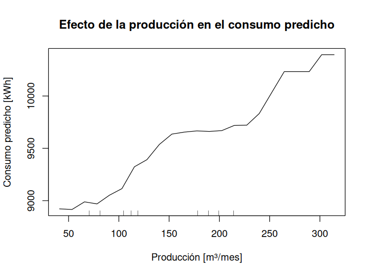

# Lección 12 · Explicar un modelo

**Objetivo:** Explicar qué variables usa un modelo y cómo cambia su predicción, con importancia por permutación y dependencia parcial.

**Proyecto asociado:** Tesis Oil Malal. Es la misma idea de IA explicable aplicada en el portafolio de gestión energética.

## Paso a paso

1. Abre RStudio con el archivo `aprendiendo-r-con-pgf.Rproj` (doble clic). Así R trabaja desde la carpeta principal del repositorio.
2. Abre el archivo [`importancia_variables.R`](importancia_variables.R) (menú **File → Open File**) y léelo junto con la explicación de abajo.
3. Ejecuta el programa completo con el botón **Source** (arriba a la derecha del editor), o escribe en la consola:

```r
source("lecciones/12_explicabilidad/importancia_variables.R")
```

4. Compara lo que aparece en la consola con el **resultado esperado**.

## Qué hace el código

- `importance = TRUE` pide al bosque calcular la **importancia por permutación**: desordena una variable en los meses que cada árbol no usó y mide cuánto aumenta el error cuadrático.
- `importance(modelo, type = 1, scale = FALSE)` entrega ese aumento del error. Mientras mayor, más importante es la variable.
- `partialPlot()` dibuja la **dependencia parcial**: se varía la producción manteniendo lo demás y se grafica la predicción promedio.
- El gráfico sube en escalones porque el modelo está hecho de árboles.

## Resultado esperado

```text
Importancia por permutación (aumento del error cuadrático al desordenar):
  produccion_m3      421973
  mes_num            161378

Gráfico guardado en: lecciones/12_explicabilidad/salidas/dependencia_parcial.png
```



## Qué aprendimos

Explicar un modelo permite verificar que use las variables con sentido físico. Estas técnicas muestran cómo el modelo usa cada variable; no prueban causalidad por sí solas.

## Ejercicio

Dibuja la dependencia parcial del mes (`x.var = "mes_num"`) y compárala con la de la producción.
